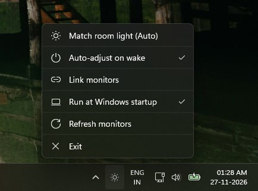
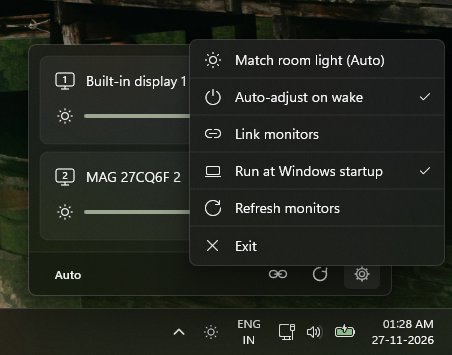

# Brightness Tray

A lightweight, native Rust Windows system tray app to control brightness across both **internal laptop displays** (via WMI `WmiMonitorBrightnessMethods`) and **external monitors** (via DDC/CI `dxva2`).

Built as a standalone replacement for the PowerToys brightness flyout with zero runtime dependencies. It ships as one 421 KB binary.


## Context Menu & Controls

Open the Fluent 2 Acrylic menu by **right-clicking** the tray icon or clicking the **Settings** gear in the flyout:

| Tray Right-Click Menu | Flyout Settings Menu |
| :---: | :---: |
|  |  |

The popup menu holds six items. **Match room light (Auto)** takes a one-shot ambient light reading (using a hardware `LightSensor` if available, or your webcam in read-only mode) and adjusts every screen; PCs with neither sensor hide it automatically. **Auto-adjust on wake** runs the same reading after sleep or opening the laptop lid, while startup and sign-in leave it alone. **Link displays** keeps brightness deltas synchronized across connected screens during any slider drag. **Run at Windows startup** registers logon launch, **Refresh displays** re-scans internal and external DDC/CI hardware, and **Exit** stops the tray app.

## Quick Start

1. Download `brightness-tray.exe` from the [latest GitHub Release](https://github.com/ferventclav/brightness-tray/releases/latest) and save it in a folder such as `C:\Tools\brightness-tray.exe`.
2. Double-click it. There is a sun icon in the system tray (or inside the `^` overflow menu until you pin it), and running the exe a second time opens the flyout instead of starting a second copy.
3. Left-click the tray icon, or press `Win+B`, arrow to the icon and hit `Enter` to open the flyout right beside it. Drag any slider or scroll over a monitor card (`±5%` per notch, `Shift` for `±1%`); precision touchpad swipes move at the same notch rate. From the keyboard, `Tab` and `Up`/`Down` move across displays and enabled footer buttons, `Left`/`Right` (`Shift` for `±1%`), `PageUp`/`PageDown` (`±10%`), `Home`/`End` (`0%`/`100%`), `A` for Auto, `L` to Link, `R` to Refresh, `Enter`/`Space` on a footer button, the `Menu` key for Settings, and `Esc` to dismiss.
4. To launch at logon, open the Settings menu and check **Run at Windows startup**. If you move the executable later, running it once from the new folder updates the startup path automatically, while turning it off in Task Manager's Startup tab shows it unchecked here.

> **Note for external monitors:** Enable **DDC/CI** in your monitor's on-screen display (OSD) menu so Windows can control its hardware backlight.

## Features

- Discover internal laptop panels (`eDP` / `LVDS` / `UDI` embedded) and external DDC/CI monitors with friendly names from `QueryDisplayConfig`.
- Render a Direct3D 11 + DirectComposition + Direct2D Acrylic flyout and menu with Segoe Fluent Icons (falling back to Segoe MDL2 Assets on Windows 10), Windows dark/light theme and accent matching, rounded corners, and per-monitor DPI scaling.
- Expose Windows UI Automation (`RangeValue`, `Toggle`, `Invoke`, focus tracking, and status announcements) for Narrator and screen readers.
- Apply changes on a background worker thread with preemptible hardware ramping and 60fps UI slider interpolation.
- Sync brightness deltas across screens via **Link displays**.
- Measure room light in three tiers. It checks a dedicated Windows `LightSensor` first with zero camera access, falls back to read-only Media Foundation webcam sampling (checking active camera use via `IMFSensorActivityMonitor` first and showing `Camera in use` or `Couldn't open camera` instead of touching a busy device), and hides Auto controls when neither hardware sensor exists.
- Recover the tray icon across `TaskbarCreated` restarts and Explorer startup delays.

## Requirements

- Windows 10 or Windows 11 (x64).
- External monitors need **DDC/CI** enabled in their OSD settings.

## Build from Source

```powershell
cargo build --release
```

The standalone executable lands at `target\release\brightness-tray.exe`. It has a single static binary and needs no external runtime.
