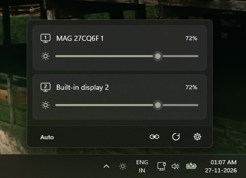

# Brightness Tray

A lightweight, native Rust Windows system tray app to control brightness across both **internal laptop displays** (via WMI `WmiMonitorBrightnessMethods`) and **external monitors** (via DDC/CI `dxva2`).

Built as a standalone replacement for the PowerToys brightness flyout with zero runtime dependencies (~240 KB binary).



## Quick Start

1. **Download:** Grab `brightness-tray.exe` from the [latest GitHub Release](https://github.com/ferventclav/brightness-tray/releases/latest) and place it anywhere you like (e.g. `C:\Tools\brightness-tray.exe`).
2. **Run:** Double-click `brightness-tray.exe`. Look for the brightness icon in your system tray (or inside the `^` overflow menu, then drag it onto the taskbar).
3. **Adjust brightness:**
   - **Left-click** the tray icon to open the flyout.
   - **Drag** a slider or **scroll the mouse wheel** over any monitor card (`±5%`).
   - Click **Auto** *(shown when your PC has a light sensor or webcam)* to match your room lighting.
   - Click the **Link** icon to adjust all monitors together.
   - Click **Refresh** if you plug in or wake an external monitor.
4. **Start with Windows:** Right-click the tray icon (or click the **Settings** gear in the flyout) and check **Run at Windows startup**.

> **Note for external monitors:** Make sure **DDC/CI** is enabled in your monitor's on-screen display (OSD) menu so Windows can control its hardware backlight.

## Features

- **Multi-monitor support:** Automatically discovers internal laptop panels (`eDP` / `LVDS` / `Internal`) and external `DDC/CI` monitors with friendly names from `QueryDisplayConfig`.
- **Windows 11 Acrylic flyout:** Direct3D 11 + DirectComposition + Direct2D UI that adapts to your Windows dark/light theme and accent color, with rounded corners and per-monitor DPI scaling.
- **Smooth transitions:** Non-blocking background worker thread with preemptible `700ms` ease-in-out cubic hardware ramping and 60fps slider animation.
- **Link monitors:** Toggle delta-synced brightness across all connected displays.
- **Adaptive Auto-Brightness (3-tier hardware fallback):**
  1. Uses a dedicated hardware **Ambient Light Sensor** (`Windows.Devices.Sensors.LightSensor`) when available (zero camera usage).
  2. Falls back to **on-demand webcam room-light sampling** (read-only, skips automatically if another app is using the camera) using a Weber-Fechner perceptual curve.
  3. On desktops/laptops with neither an ALS nor a webcam, cleanly hides the **Auto** controls so only manual sliders, **Link**, **Refresh**, and **Settings** are shown.
- **Resilient tray icon:** Re-registers on `TaskbarCreated` and retries at logon if Explorer is still starting up, plus **Run at Windows startup** toggle.

## Requirements

- Windows 10 or Windows 11 (x64)
- External monitors must have **DDC/CI** enabled in their OSD settings to be controllable.

## Build from Source

```powershell
cargo build --release
```

The standalone executable is output at `target\release\brightness-tray.exe`.
